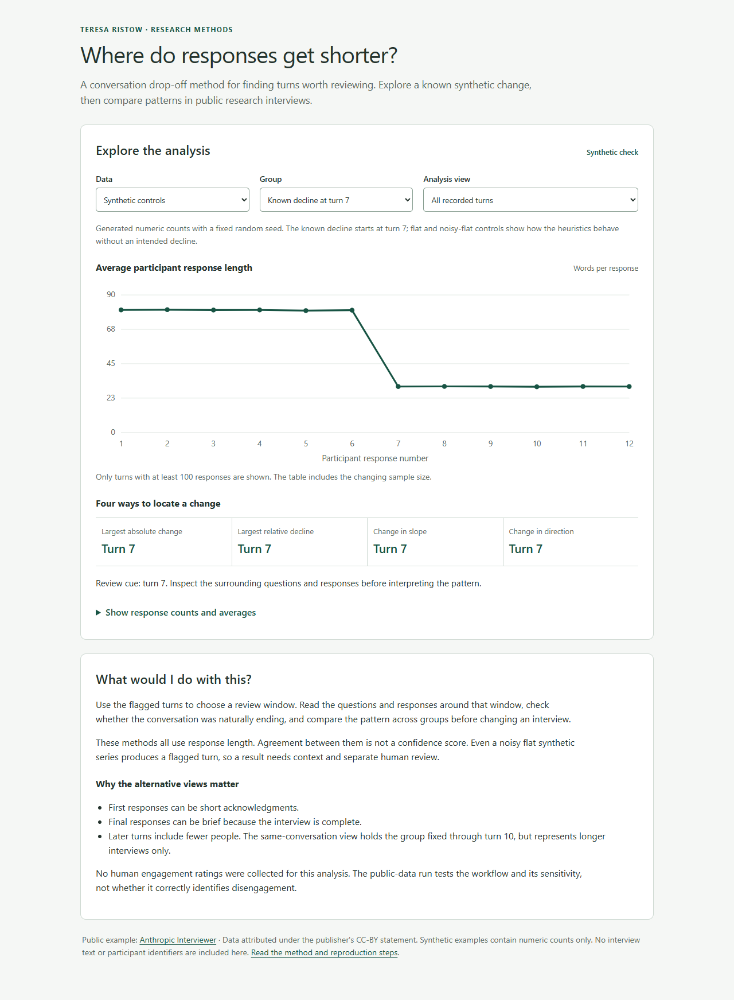

# Conversation Drop-off Analysis

**Where do responses in a research conversation get shorter, and what should we review before changing the interview?**

This project turns that question into a repeatable analysis and an interactive readout. It combines four transparent response-length heuristics, data-quality checks, SQL aggregation, and sensitivity analyses. The results identify review windows; they do not establish that a participant disengaged.

**[Open the interactive example](https://tristowww.github.io/conversation-dropoff-analysis/)** · [Read the findings](docs/FINDINGS.md) · [Method and assumptions](docs/METHOD.md) · [Data attribution](docs/DATA.md)



## What a decision-maker can learn

- Which turns deserve a closer look at the interview question and response.
- Whether the pattern changes when opening acknowledgments or each conversation's final response are excluded.
- Whether the pooled pattern holds in different groups, with response counts visible.
- Which conclusions need additional human evidence before changing a conversation flow.

The public example uses **1,250 interviews** from the official Anthropic Interviewer release. Four methods on the pooled series flag turns **4, 10, and 14**, rather than agreeing on a single universal drop-off point. Excluding final responses changes one result. That sensitivity is part of the finding, not something to hide.

## Explore without installing anything

Open `demo/index.html` in a browser, or use the interactive link above. The bundled example works locally without a server, external scripts, or model/API access. Start with the synthetic data, where the intended change is known, then switch to the public interviews.

The noisy-flat synthetic control is deliberately included: all four methods can agree on a turn even when no downward trend was designed. Agreement is not an accuracy estimate.

## Reproduce the analysis

Python 3.10 or later; standard library only. Commands below run from the repository root.

```bash
# Verify the method on small controls and edge cases.
python -m unittest discover -s tests -v

# Download the official public release at a pinned revision.
# Raw transcripts stay in an ignored local directory.
python scripts/download_anthropic.py

# Parse interviews, check data quality, compare SQL/Python aggregates,
# and regenerate aggregate results and the browser example.
python scripts/run_analysis.py
```

The download script verifies SHA-256 hashes. The analysis checks the schema, duplicate transcript IDs, role sequences, empty messages, sample sizes, and SQL/Python agreement. Both `AI:` and `Assistant:` are interviewer labels in the source format.

## Project contents

| Path | Purpose |
| --- | --- |
| `conversation_dropoff/analysis.py` | Parsing, aggregation, four diagnostics, and sensitivity views |
| `sql/turn_summary.sql` | Independently checked SQL aggregation |
| `scripts/` | Source download and reproducible analysis |
| `tests/` | Synthetic controls and meaningful edge cases |
| `data/synthetic_turns.csv` | Generated numeric examples with a fixed seed |
| `results/` | Aggregate results and data-quality audit, without transcript text or IDs |
| `demo/` | Interactive explanation for a nontechnical reader |
| `docs/` | Findings, interpretation, assumptions, and data attribution |

## Scope and contribution

Teresa Ristow developed the research-method concept and its interpretation. This standalone implementation and portfolio presentation were prepared with AI assistance and checked through executable tests and a fresh run on public data. It is a research prototype, not a validated engagement classifier.

No employee dataset, interview excerpts, participant identifiers, or private system integrations are distributed. The synthetic examples contain invented numeric counts. The public-data output suppresses cells with fewer than 100 responses. This is a conservative display choice, not a formal anonymity guarantee.

## Next validation step

Use independently collected human judgments of conversational engagement and natural completion to test whether the review cues are useful. Freeze the rating instructions and analysis choices before making accuracy claims. The current release includes no such ratings.
